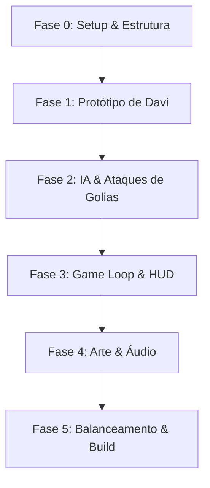

# Plano de Implantação: Davi vs Golias (2D)

## 1. Visão Geral do Projeto
- **Gênero:** Ação 2D / Boss Arena (estilo combate tático ágil contra chefe gigante).
- **Perspectiva:** Visão Lateral 2D em arena fechada (permite enfatizar a diferença monumental de altura entre Davi e Golias).
- **Engine:** Godot 4.x (Standard / GDScript).
- **Diretório Raiz:** `d:\Projects\game1`

---

## 2. Pilares de Gameplay
1. **Davi (Agilidade e Precisão):**
   - Movimentação horizontal rápida e salto/rolamento de esquiva (*dash* com invulnerabilidade).
   - Sistema de funda: segurar tecla para girar e aumentar força; soltar para disparar a pedra com física parabólica.
   - Recurso estratégico: **5 pedras**. Ao esgotar, Davi precisa buscar mais pedras no riacho (área demarcada na arena).
2. **Golias (Força Bruta e Padrões Lentos):**
   - Altura de 3 a 4 vezes o tamanho de Davi.
   - Movimentação pesada e ataques telegrafados (aviso visual antes do impacto).
   - **Multiplicadores de dano:** Corpo (armadura, dano leve) vs Cabeça/Testa (ponto fraco crítico + atordoamento temporário).

---

## 3. Fases de Desenvolvimento (Roadmap)

### Fase 0: Setup do Ambiente e Estrutura Inicial (Concluída)
- [x] Baixar e configurar o executável do Godot 4 (Godot 4.7.2 portátil instalado em `d:\Projects\game1\engine`).
- [x] Criar o arquivo `project.godot` com resolução base (1280x720).
- [x] Criar scripts de inicialização rápida (`run_game.bat` e `open_editor.bat`).
- [x] Criar árvore de diretórios (`scenes/`, `scripts/`, `assets/sprites/`, `assets/audio/`).

### Fase 1: Mecânicas de Davi (Player) (Concluída)
- [x] **Movimentação:** `CharacterBody2D` com gravidade, aceleração e salto (`david.gd`).
- [x] **Esquiva (Dash/Roll):** Impulso rápido com invulnerabilidade temporária (`Shift`, `C` ou Botão Direito).
- [x] **Projétil (Pedra):** `stone.gd` com física parabólica, cálculo de colisão e desacoplamento de dano.
- [x] **Funda:** Carregamento dinâmico segurando o botão do mouse/espaço, com linha de previsão de trajetória.
- [x] **Munição:** Contador limitado a 5 pedras e recarga no riacho do Vale de Elá (`BrookArea`).

### Fase 2: Mecânicas de Golias (Boss) (Concluída)
- [x] **Estrutura de Caixas de Colisão:**
  - `BodyArea`: dano reduzido (10 pts).
  - `HeadArea`: ponto fraco crítico na testa (35 pts) que aciona imediatamente o estado `STUNNED`.
- [x] **Máquina de Estados de Golias:**
  - `IDLE`, `WALK`, `TELEGRAPH_PUNCH`, `ATTACK_PUNCH`, `PUNCH_RECOVERY`, `TELEGRAPH_STOMP`, `ATTACK_STOMP`, `STUNNED`, `DEAD`.
  - Onda de choque física (`shockwave.gd`) disparada no solo durante o pisão.
  - Modo Fúria (*Enrage*) automático quando Golias atinge menos de 40% de vida (ataques mais rápidos e agressivos).

### Fase 3: Game Loop e Interface (HUD) (Concluída)
- [x] **HUD (`ui.gd` / `ui.tscn`):**
  - Barra de vida de Golias no topo com estado atual.
  - Indicador de 3 corações de vida de Davi.
  - Contador de pedras no alforje (5/5) com aviso visual ao esgotar.
  - Barra de carregamento da força da funda.
- [x] **Game Loop:**
  - Telas de Vitória e Derrota estilizadas.
  - Reinício rápido pressionando `[ R ]`.

### Fase 4: Áudio e Arte (Concluída)
- [x] **Efeitos Sonoros Sintéticos Procedurais (`audio_manager.gd`):**
  - Som de lançamento da funda (*Whoosh*).
  - Som de impacto no corpo (*Thud* abafado).
  - Som metálico triunfante de acerto crítico na testa.
  - Som grave de impacto do punho no solo.
  - Som de rolamento/esquiva de Davi.
  - Som de água ao recolher pedras no ribeiro.
  - Tambores de guerra rítmicos marcando a atmosfera do duelo.
- [x] **Feedback Visual & Game Feel:**
  - **Textos Flutuantes de Dano (`floating_text.gd`):** Números brancos (`-10`) e texto dourado saltitante (`CRÍTICO! -35`).
  - **Estrelas de Atordoamento:** Indicadores dourados oscilando na cabeça de Golias durante o *Stun*.
  - **Balões de Diálogos Bíblicos (`speech_bubble.gd`):** Provocações e respostas diretas da passagem bíblica durante o combate.

### Fase 4.5: Melhorias de Jogabilidade e Visual (Concluída)
- [x] **Arte procedural animada** (sem arquivos de imagem): Davi pastor (cabelo ruivo, pele de carneiro, alforje, funda girando) e Golias (couraça de escamas de bronze, grevas, capacete com penacho filisteu, barba, dardo nas costas e lança enorme), com poses para cada ataque.
- [x] **Cenário do Vale de Elá:** céu em degradê, sol, nuvens e pássaros, montanhas, acampamentos de Israel e dos filisteus com tendas, bandeiras ao vento e soldados que comemoram, oliveiras, chão com pedrinhas e grama, ribeiro animado.
- [x] **Davi:** controle mais gostoso (aceleração, "coyote time", pulo variável), esquiva também no ar, mira por teclado (F + W/S), anel de carga da funda e trajetória pontilhada.
- [x] **Pedras:** recolhidas uma a uma no ribeiro; pedras que erram ficam no chão para pegar de novo.
- [x] **Golias:** novo ataque de **lança arremessada** com mira visível, soco que acerta também quem está embaixo dele, pisão com onda de pedras (duas ondas na fúria), rugido ao entrar em fúria, cabeça abaixa no soco e no atordoamento (janela para acertar a testa).
- [x] **Avisos para criança:** ícone "!" sobre Golias e frases de dica ("Pisão! PULE a onda de pedras!").
- [x] **Queijo** que cai do céu e recupera 1 vida (1 Samuel 17:18).
- [x] **Game feel:** congelamento no acerto crítico, zoom, tremor de câmera, partículas (poeira, faíscas, água), câmera lenta no golpe final.
- [x] **Telas:** título com escolha de dificuldade (Fácil/Normal/Difícil), pausa (P/Esc), vitória com tempo, precisão e recorde salvo, derrota com dica.
- [x] **Áudio** refeito em 16 bits (antes saía distorcido) com novos sons e tambores de guerra em ritmo.
- [x] **Robô de testes:** `engine\Godot_v4.7.2-stable_win64_console.exe --path . -- --autoplay` (opções `--diff=0|1|2`, `--passive`, `--idle`). Não salva recordes.

### Fase 5: Balanceamento e Exportação
- [ ] Calibração das janelas de reação e velocidade de projétil.
- [ ] Exportação final.

---

## 4. Próxima Ação Imediata
Jogar com o seu filho e anotar o que está fácil/difícil demais para a **Fase 5** (balanceamento). A versão anterior está guardada em `_backup_v1/`.
